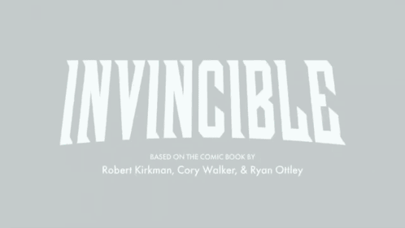

<h1 align="center">Hello, I'm Ferdin Arsenarendra – Trying My Best to Be ...</h1>

  

---

🗨️ *"I wasn't ready before, but now I am"*  
*I’m not just strong, I’m getting stronger – with every line of code.*

---

### 🧬 About Me

- 🎓 Undergraduate student at **Institut Teknologi Bandung**/**Computer Science** major.
- ⚙️ I have an interest in **low-level systems**, **machine learning**, **software engineering**, and **data analyst**.

---

### 🛠️ Superpowers (Tech Stack)

---

### 📊 Battle Stats

  
  

---

### 📡 Contact Me 👇

---

  <i>"I fight because it’s the right thing to do."</i> 
  <b>– Me, probably after debugging for 3 hours</b>

